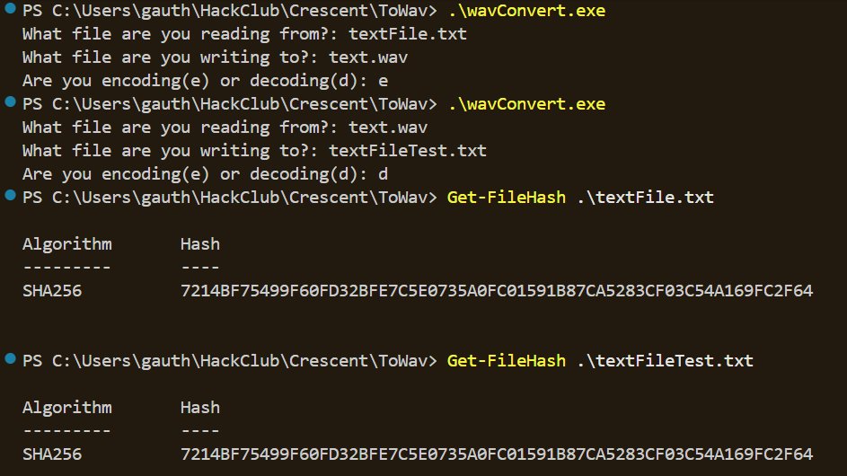

# Usage

## Running
To encode the original file, you can just run the exe file and respond to the prompts:
```bash
.\wavConvert.exe
```
You can also add your file names in the command arguments:
```bash
.\wavConvert.exe exampleInput.txt exampleOutput.wav
```

When encoding, this will create an output .wav file with the raw bytes in the place of where the audio data goes. It will have a very high chance of sounding like static(lower your volume).

## Recompiling
To compile it yourself:
```bash
g++ .\main.cpp -o wavConvert.exe; .\wavConvert.exe
```


# Demo
Since it makes audio files, I can't really attach one here elegantly. 
To try it out, decode the catMusic.wav file in the repo:
```bash
.\wavConvert.exe catMusic.wav cat.jpg
```
<br>
Here is my SHA256 test on the original vs decoded files:
<br><br>



## File info
The encoding is added under the audio data which is split into samples of 2 bytes each. I got my header info from [here](https://docs.fileformat.com/audio/wav/). My encoded files are fixed at mono audio, 44100 samples per sec, and 88.2 KB per sec.